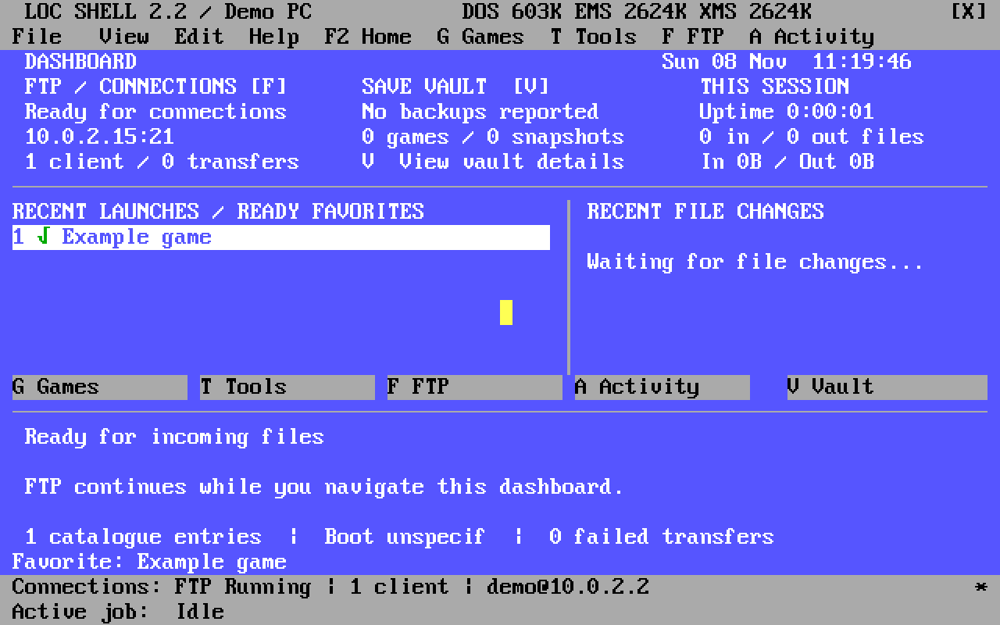

# LOC SHELL: the simple user guide

[Back to LOC SHELL](../README.md) · [Install a game](INSTALL-GAMES.md) · [Use an agent](AGENT-GUIDE.md)

**Your old PC runs the games. Your modern computer sends files to it. LOC SHELL
gives you a menu and handles the connection.**

Start here if you want to do things yourself. No agent is required. Follow one
numbered list at a time; you do not need to read the whole guide first.

## Start here: play a game

1. Start your retro PC using the boot choice that normally starts LOC SHELL.
2. If you are at a DOS prompt instead, type `C:\DOSSHELL\LOCSHELL.BAT` and press
   **Enter**. If that file is missing, use the [first-time setup guide](SETUP.md).
3. Press **F2** to open Home. Click a recent game, or press **G** for Games.
4. In Games, use the arrow keys to select a game. Press **Enter** to run it.
5. Quit using the game's own Quit/Exit command. LOC SHELL comes back.

While a game runs, file transfers are unavailable. They return when the game
ends. This gives the game back memory that the shell and network service used.

If launching waits for a connection to close, disconnect your file-transfer app
on the modern computer. **Esc** cancels the waiting launch.

## Find just the part you need

- [Install a game from your modern computer](INSTALL-GAMES.md).
- [Send files and find connection details](#send-something-from-your-modern-computer).
- [Receive settings or system changes](#receive-changes-and-settings).
- [Understand the memory marks](#what-does-the-mark-beside-my-game-mean).
- [Fix a problem](#if-something-goes-wrong).

## What can I do with it?

| I want to… | LOC SHELL helps by… |
| --- | --- |
| Play a game | Giving you a game menu and recent-game shortcuts. |
| Add a game from my modern computer | Receiving its files over your network; you then add its start file to the menu. |
| Change a game's sound or other settings | Starting the game's setup program, or receiving a replacement configuration file. |
| See whether I have enough memory | Showing a memory status beside the game. |
| Watch an update arrive | Showing the incoming file, progress and recent file changes on Home. |
| Have a helper maintain the PC | Accepting files and scheduled DOS commands from a connected computer. |
| Leave it sitting on the desk | Showing a screensaver while the file service remains available. |

It does not download games for you. Copying a ZIP to the PC does not install it.
It cannot make a game compatible with hardware the game does not support.

The backup card shows available backup information. **Automatic save-game sync
between PCs is not active yet.** Keep making your normal backups.

## Know these keys

| Key | What it does |
| --- | --- |
| **F2** | Home: recent games, connections, incoming files and jobs. |
| **Enter** | Run the selected game, or activate the selected control. |
| **Tab** | Move between controls. On ordinary views, focus the left menu. |
| **Esc** | Close a dialog or return from a view to Games. |
| **F4** | Explain the selected game's memory status. |
| **F5** | Refresh memory and setup information. |
| **F6** | Open the FTP connection controls. |
| **F7** | Record/check memory use for the selected game. |
| **F9** | Explain the last launch attempt. |

You can use the mouse too. A click or key wakes the screensaver; that first
click/key is used only to wake it.

## Understand Home

*Recorded with sample files in a DOS emulator. The transfers are paced to make
the progress easy to follow.*

**Recent launches** are shortcuts, not extra installations. The list fills as
you launch games and tools. Ready-to-run favorites may fill empty spaces.

**FTP** is the file-receiving service. **Running** means it can accept a
connection. The address is the number your modern computer needs to connect.
An idle connected computer is not the same as a file being transferred.

**Recent file changes** shows files received/sent and other file operations.
This history is for the current service session.

**The wide work panel** shows the current file or maintenance job. A transfer
can show bytes and speed without a percentage: sometimes its final size is
not supplied by the sender.

**The two bottom rows** stay visible on other pages:

- **Connections:** whether FTP is available and who is connected.
- **Active job:** the transfer or job being handled. A moving symbol means
  progress, a dot means waiting, `+` means completed and `!` means failed.

**The backup card** includes a report time. It is a report about backups, not
a live check of every save on this PC.

## Send something from your modern computer

Use a file-transfer app, also called an **FTP client**, on your modern computer.
Do not install an FTP *server* there. The old PC is already the server.

Use the [game installation walkthrough](INSTALL-GAMES.md) for exact connection
and copying steps. You can use the same connection to send ordinary documents
or prepared configuration files.

Keep this connection card somewhere private:

| Detail | Your value |
| --- | --- |
| Retro PC's current address, shown by LOC SHELL | ____________________ |
| FTP port, normally 21 | ____________________ |
| FTP username supplied during setup | ____________________ |
| Where your password is kept | ____________________ |
| FTP `/` maps to, normally `C:\` in this setup | ____________________ |
| Folder where games belong | ____________________ |

Use plain **FTP** on your trusted local network. SFTP and FTPS are different
services and will not connect to LOC SHELL. FTP does not encrypt passwords or
files; keep this service off the public Internet.

## Receive changes and settings

You can leave LOC SHELL open and browse while ordinary files arrive. Leave it
on **Home** if you want to watch them.

| What arrives? | What happens next? |
| --- | --- |
| A new game folder | The files are stored. Add the game to the menu, then test it. |
| A game's settings file | The file is stored. The game normally uses it next time it starts. |
| A maintenance job from a helper | FTP pauses, the job runs, then LOC SHELL and FTP return if the job finishes normally. |
| An update to LOC SHELL itself | It queues a reload. Finish/cancel your edit and disconnect the sender so it can restart. |
| A change to a DOS boot file or driver | It takes effect when that component is next loaded; this often needs a deliberate reboot. |

**A successful copy means the file arrived. It does not prove the game or new
setting works.** Try it afterwards.

Download a copy of an existing settings file before replacing it. Keep the
game closed during the change. A DOS settings file must remain plain text in
the format the game expects; do not save it as a Word document.

Some files that LOC SHELL manages itself are protected from changes through
live FTP. This includes its game list, learned memory records and recent
history. Change the game list using **Edit** in LOC SHELL, or use the
[agent's managed update procedure](AGENT-GUIDE.md#for-the-agent-technical-working-rules).

An incoming file cannot supply a missing sound card, fix every memory conflict,
or answer an interactive game installer. A helper may need you at the keyboard.

## What does the mark beside my game mean?

| Status | What to do |
| --- | --- |
| Green check / **Runs** | Current memory fits documented needs or a recorded working session. Try the game. |
| Green check with amber warning | Memory fits a previous working run, but the current setup needs review. Press **F4**. |
| **Boot XM**, or another boot name | Restart into that machine's indicated boot choice before playing. |
| **Low RAM** or **Less RAM** | Press **F4**. The present memory arrangement may not be enough. |
| **Unknown**, **Confirm**, **Setup diff** or **Incomplete** | The evidence is missing or needs review; this is not proof the game is broken. |

To record a real playing session:

1. Select the game. Press **F7**, then **L** to arm one learning run.
2. Start it normally. Play far enough to check the game and its music/sound.
3. Quit normally. Answer the question about gameplay and music honestly.
4. Choose **Not sure** if you did not test them. Use **F4** to review the result.

A green check is a memory guide, not a promise about every level, save or device.

## Change the screensaver

1. Click **Screensavers** in the left menu. From Home, open Games first with **G**.
2. Select the saver with the arrow keys. Press **Enter** to save that choice.
3. Press **P** to preview it. Disconnect FTP clients so the preview can start.
4. Press **I** to set the idle delay. Zero disables automatic saving.

Island is the default when no choice was saved. It needs its separate scene
files. Sculpture and Mandelbrot need a compatible math coprocessor. If the
required hardware, files or memory are unavailable, a fallback may be used.

## If something goes wrong

| I see… | Try this first |
| --- | --- |
| FTP **Stopped** | Press **F6**, then **S** to start it. **A** changes whether it starts with LOC SHELL. |
| FTP **Unavailable** | Check the cable, packet driver and network configuration. Use the setup helper if needed. |
| Connection refused while a game/job runs | Let it finish and reconnect. This pause is expected. |
| **Add** or **Edit** is greyed out | Choose **File → Lock…**, then confirm unlocking. |
| Copied game is missing from the menu | Copying does not add a menu entry. Follow [Add it to the menu](INSTALL-GAMES.md#3-add-it-to-the-menu). |
| Game immediately returns to the menu | Press **F9**. Check the start filename, folder and required boot mode. |
| An update seems to wait forever | Finish/cancel your edit and disconnect the FTP client. |
| A remote job seems stuck | Ask the helper to inspect the **same job**. Do not keep submitting it or reboot just because a client timed out. |
| Backup card has no report | There may be no report installed. This is separate from whether your game runs. |

If you need help, note the game name, the exact message and what you clicked.
Those three things are more useful than trying several unrelated settings.
